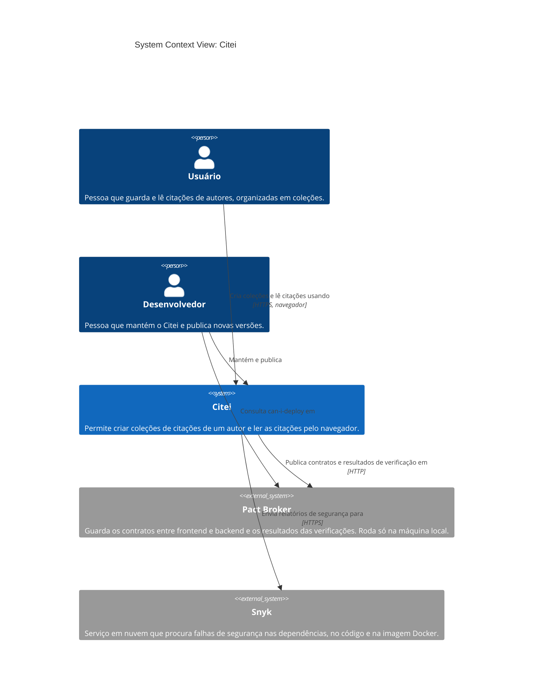

# Citei: System Context (C4, nível 1)

## Legenda

| Elemento | Tipo | Observação |
|---|---|---|
| Usuário | Pessoa | Usa o Citei no navegador. |
| Desenvolvedor | Pessoa | Mantém o código e roda os testes. |
| Citei | Sistema | Frontend (`citei-webapp`), API (`citei-backend`) e banco PostgreSQL. No nível 1 eles formam uma caixa só. |
| Pact Broker | Sistema externo | Só em desenvolvimento. |
| Snyk | Sistema externo | Só em desenvolvimento. |
