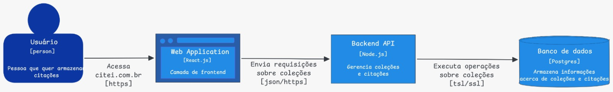

# Citei: Container (C4, nível 2)

## Legenda

| Container | Tecnologia | Porta |
|---|---|---|
| citei-webapp | React 19, Vite 7, nginx | 80 no container |
| citei-backend | Express 4, TypeORM 0.3 | 3000 no container, 3123 no host |
| PostgreSQL | postgres:16-alpine | 5432 |

Os três containers compartilham a rede Docker `citei-net`.
